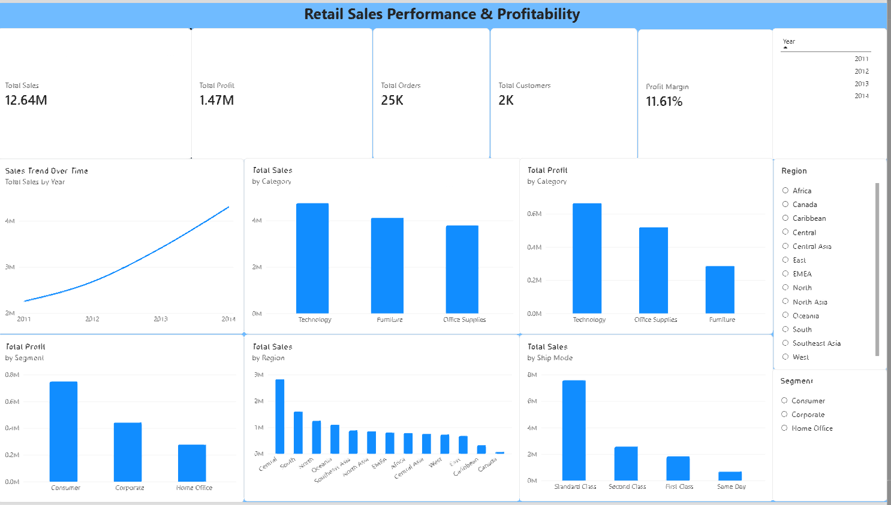

# Retail Sales Performance & Profitability Dashboard

## 📊 Project Overview

This project analyzes retail sales performance and profitability using Power BI.

The dashboard was created to understand sales trends, profitability, customer segments, product categories, regions, and shipping methods.

## 🎯 Objectives

- Analyze sales performance over time
- Evaluate profit and profit margin
- Identify the best-performing product categories
- Analyze sales performance by region
- Compare customer segments
- Analyze sales based on shipping methods

## 🛠️ Tools

- Power BI
- Power Query
- DAX
- Excel

## 📈 Dashboard

## 🔍 Key Insights

- Sales showed an increasing trend from 2011 to 2014.
- Technology generated the highest sales and profit among the product categories.
- The Consumer segment contributed the highest profit compared with Corporate and Home Office.
- Central region recorded the highest sales among the regions.
- Standard Class was the shipping method with the highest sales.

## 💡 Recommendations

- Maintain and strengthen sales strategies for the Technology category.
- Develop targeted strategies for the Consumer segment due to its strong profit contribution.
- Evaluate lower-performing regions to identify opportunities for improving sales.
- Review shipping strategies to maintain delivery efficiency and profitability.

## 📌 Conclusion

This dashboard provides an overview of retail sales performance and profitability and demonstrates the use of Power BI to transform raw data into actionable business insights.
